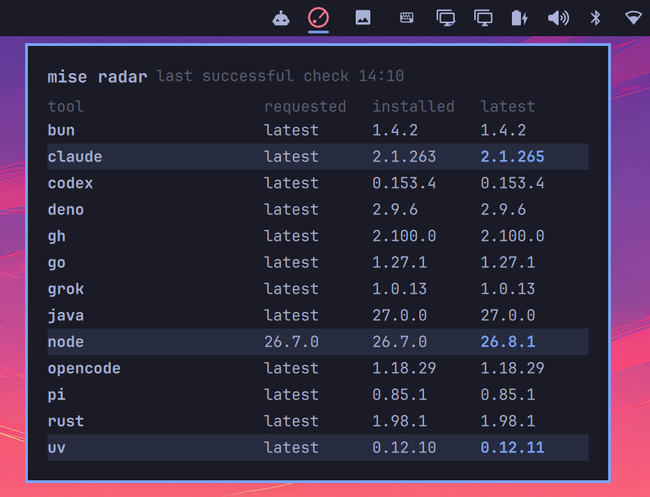

# TMOS mise radar

A fork of [chyld/omarchy-mise-radar](https://github.com/chyld/omarchy-mise-radar) — MIT, © Chyld
Medford. The radar itself, and most of this code, is Chyld's. This fork adds one-click upgrades per
tool, the configurable stack watcher described below, and TMOS branding; the original `LICENSE` is
retained unchanged.

Agent harnesses move every week. A stale Claude, Codex, or OpenCode pin can mean a new model is out and your CLI does not even know it exists. mise radar watches the tools you actually use on [Omarchy](https://omarchy.org) and turns the bar red when one falls behind latest, including brand-new releases mise would otherwise hide. Click for requested, installed, and latest.



It can also watch **your own Docker stacks**, wherever they run. Name them in the `services`
setting and the panel checks each one over ssh, showing image updates with security and
breaking-change flags. With nothing configured, no process runs and the section does not appear.

## Watching your own stacks

```sh
omarchy bar set tmos.mise-radar services \
  '[{"id":"media","name":"Home media","host":"minipc","script":"/srv/home-media/repo/scripts/stack-updates.sh"}]' --json
```

Each entry names an ssh host and a script on that host. The script is called as `<script> check`
and `<script> update SERVICE`, and is expected to print one JSON object:

```json
{"services":[{"name":"plex","current":"1.41.0","latest":"1.41.2","outdated":true,"security":"high","reasons":["CVE-2026-1234"],"notesUrl":"https://example.invalid/notes"}]}
```

`security` is one of `critical` / `high` / `medium` / `low` / `mentioned`; `breaking` and
`reviewRequired` mark updates that want a look before running. Rows from every target are merged,
security first, and each update runs on the host that owns the row.

A host or script that does not look like a host or an absolute path is dropped rather than run, and
the remote data is validated before anything is drawn. Set up keyless ssh to the host first:
`ssh minipc true` must not ask for a password.

## Media stack updates in this fork

The panel shows running and latest image versions for the 18 active Compose
services. A shield marks an update with a security fix mentioned in upstream
release notes or advisories. A warning marks a possible breaking change or an
update whose notes could not be assessed. Open the linked notes before using
an individual update button. Updates needing review require two clicks; the
bulk button includes only updates with reviewed notes and no warning.

The check runs over SSH every four hours while the widget is active. Updating
pulls and recreates the selected Compose service on the mini PC. The mini PC
must have `scripts/stack-updates.sh` and `scripts/stack_release_notes.py` in
`/srv/home-media/repo`, plus Docker, Buildx, jq, Python 3, and working registry
access. The release analysis uses public GitHub and Plex data; it is a helpful
warning, not a complete vulnerability scan.

## New in 1.2.0

- A minimal radar icon with a thin ring, sweep line, and signal dot.
- Omarchy 4.0.3 and PeekBar compatibility through one shared internal service.
- Last successful results stay visible when a refresh fails; polling stops
  when the last widget is removed.
- Strict response validation, bounded output, isolated Python execution,
  and cleanup of owned child processes.
- Regression tests for the data model, process supervisor, and real QML
  service/popup integration across multiple widgets.

## Install

```sh
omarchy plugin add https://github.com/chyld/omarchy-mise-radar.git --enable
```

Omarchy already includes mise. You do not need to install anything else.

## Update

```sh
omarchy plugin update chyld.mise-radar
omarchy restart shell
```

Restart the shell after this update so it loads the new QML service definition.

## Remove

```sh
omarchy plugin remove chyld.mise-radar
```

Removal stops radar polling and cancels its owned checks. It deletes the plugin
files at `~/.config/omarchy/plugins/chyld.mise-radar/`. It keeps mise itself,
`~/.config/mise/config.toml`, installed tools under `~/.local/share/mise/`, and
mise's shared cache under `~/.cache/mise/` (or their XDG equivalents). Radar
creates no separate persistent cache, credentials, service units, or grants.

## What it shows

- Quiet radar icon when everything is current
- Red radar when something is behind
- Panel table: tool, requested constraint, installed, latest

Latest comes from `mise outdated`, including brand-new releases mise would otherwise hide. That matches [mise-versions.jdx.dev](https://mise-versions.jdx.dev) more closely than mise's default delay.

## When it refreshes

When the first widget loads, when you open the panel, and every 4 hours while
at least one widget is active. Removing the last widget stops polling and
cancels any in-flight check.

A failed check keeps the last successful results and their timestamp visible,
with an error message. Invalid responses never mark your tools as up to date.

The widgets share one internal QML service across monitors. This works with
the standard bar and replacement bars such as PeekBar, including Omarchy
4.0.3's restricted shell service access.

## Mise updates

The mise panel retains its own update controls. Media-stack updates use the
separate SSH and Compose path described above.

## Data, network, and execution

Radar runs the root-owned `/usr/bin/mise` from your home directory with only
these argument lists: `--version`, `ls --json --current`, and
`outdated --bump --json`. It reads the tools configured for that directory,
including your global mise configuration. It does not follow the active
terminal's project or its environment overrides.

Version checks can contact the version services, package registries, release
APIs, and custom version URLs selected by your configured
[mise backends](https://mise.jdx.dev/dev-tools/backends/). Examples include
`mise-versions.jdx.dev`, `api.github.com`, and `registry.npmjs.org`; this is
not an exhaustive endpoint allowlist. These requests disclose the requested
tool/package and the normal connection metadata to those services. Radar
has no separate analytics, credential store, or networking client. The stack
checker uses SSH and the mini PC's registry and release-note access. Existing
mise configuration and installed mise plugins remain part of the trusted
local toolchain; their network behavior is controlled by mise, not filtered
by radar. Private registries may require their existing mise configuration.

The helper receives a minimal environment: the account's home directory,
`PATH=/usr/bin:/bin`, `LANG=C.UTF-8`, absolute XDG config/data/cache/state
locations when set, and `MISE_MINIMUM_RELEASE_AGE=0`. It does not forward
ambient tokens, proxy variables, runtime injection variables, or arbitrary
`MISE_*` overrides. Python runs with `-I -S -B`.

Radar keeps display results only in memory. Mise may update its own metadata
cache, normally `~/.cache/mise/` or `$XDG_CACHE_HOME/mise`; that cache survives
removal. See [mise's directory configuration](https://mise.jdx.dev/configuration.html#mise-cache-dir).
Quickshell manages its own runtime logs and QML cache; these also survive
plugin removal. Raw command output and tool versions are not logged by radar.

The supervisor caps command stdout at 255 KiB and discards mise stderr. QML
also bounds collected chunks before concatenation. Accepted documents are
limited to 64 tools, 16 versions per tool, 128 characters per displayed field,
eight levels of JSON nesting, and 8,192 values. Malformed or oversized data
is rejected as a whole, preserving the last successful snapshot. Python
owns command deadlines and process-group cleanup; QML provides a longer
fallback watchdog. These limits protect the shell's input boundary; they do
not impose a byte limit on mise's internal HTTP client.

## Development

```sh
node --test tests/model.test.js
/usr/bin/python3 -I -S -B -m unittest discover -s tests -p supervise_test.py
omarchy plugin validate .
# Integration tests require a running Wayland session and Omarchy/Quickshell.
# They use controlled responses, without invoking mise or modifying the desktop.
/usr/bin/python3 -I -S -B tests/qml_test.py
```

## License

MIT
